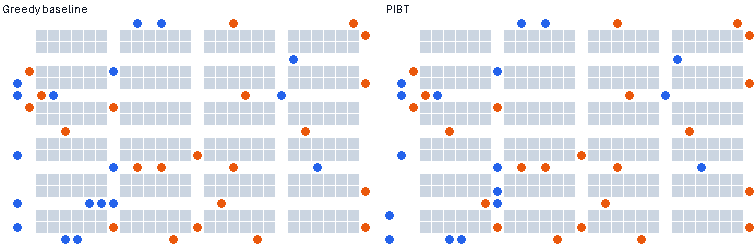
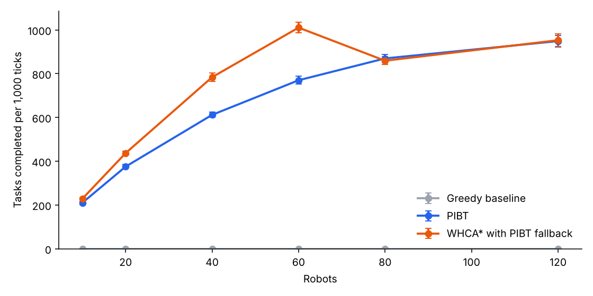
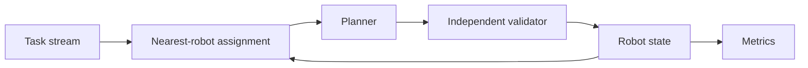

# Warehouse Fleet Simulator

[](https://github.com/Niyi-Momoh/warehouse-fleet-sim/actions/workflows/ci.yml)

A Python simulator for coordinating up to 120 robots through a warehouse with single-width
aisles. Robots receive a continuous stream of pick-and-deliver tasks, and three planners
are benchmarked on throughput, task time, planning latency and safety. Every move is
checked by a validator that shares no code with the planners.



*Same warehouse, 40 robots. Blue robots are heading to a shelf and orange robots are carrying
an item to a station.*

## Results



<!-- results:start -->
90 runs on a 31 by 19 warehouse with 301 free cells and 6 stations. Each run lasts 1200 ticks, and the first 200 are excluded. Figures are means over 5 seeds.

| Robots | Planner | Tasks per 1,000 ticks | Mean task time (ticks) | Waiting | Plan time p99 (ms) | Longest stall (ticks) | Fallback ticks |
|---:|---|---:|---:|---:|---:|---:|---:|
| 10 | Greedy baseline | 0 | None finished | 100% | 0.08 | 1165 | 0 |
| 10 | PIBT | 210 | 47.5 | 1% | 0.07 | 26 | 0 |
| 10 | WHCA* with PIBT fallback | 228 | 43.6 | 0% | 0.72 | 23 | 0 |
| 20 | Greedy baseline | 0 | None finished | 100% | 0.11 | 1168 | 0 |
| 20 | PIBT | 375 | 52.9 | 3% | 0.12 | 20 | 0 |
| 20 | WHCA* with PIBT fallback | 437 | 45.6 | 1% | 1.48 | 16 | 0 |
| 40 | Greedy baseline | 0 | None finished | 100% | 0.24 | 1172 | 0 |
| 40 | PIBT | 612 | 65.3 | 7% | 0.23 | 13 | 0 |
| 40 | WHCA* with PIBT fallback | 784 | 50.7 | 3% | 4.93 | 8 | 3 |
| 60 | Greedy baseline | 0 | None finished | 100% | 0.27 | 1181 | 0 |
| 60 | PIBT | 770 | 77.5 | 11% | 0.25 | 13 | 0 |
| 60 | WHCA* with PIBT fallback | 1011 | 59.5 | 5% | 14.34 | 7 | 270 |
| 80 | Greedy baseline | 0 | None finished | 100% | 0.56 | 1181 | 0 |
| 80 | PIBT | 870 | 91.3 | 15% | 0.48 | 10 | 0 |
| 80 | WHCA* with PIBT fallback | 859 | 91.5 | 15% | 13.42 | 10 | 1186 |
| 120 | Greedy baseline | 0 | None finished | 100% | 0.93 | 1197 | 0 |
| 120 | PIBT | 949 | 125.0 | 23% | 0.70 | 10 | 0 |
| 120 | WHCA* with PIBT fallback | 953 | 124.7 | 23% | 13.72 | 9 | 1200 |

| Success criterion, set before the benchmark | Measured | Result |
|---|---:|---|
| No safety violations in any run | 0 | Pass |
| Coordinated plan time p99 at most 50 ms at 80 robots | 14.95 ms | Pass |
| Coordinated planners never stall over 100 ticks | 26 ticks | Pass |

- WHCA* completed 9% to 31% more tasks than PIBT with 10 to 60 robots, with p99 planning time 10 to 58 times higher.
- At 80 robots WHCA* used its PIBT fallback on 99% of ticks, so the two planners perform almost identically at that density and above.
<!-- results:end -->

Fallback ticks count the whole run, including warm-up. The greedy baseline is deliberately
minimal and has no way to recover from a head-on meeting, so it mainly shows why coordination
is needed. The useful comparison is between PIBT and WHCA*.

## The planners

| Planner | Approach | Strength | Weakness |
|---|---|---|---|
| Greedy | Each robot follows its shortest path and waits if blocked | Very simple | Head-on meetings in an aisle never resolve |
| PIBT (Okumura et al.) | Robots lend priority to whichever robot blocks them, one tick at a time | Very fast and holds up at high density | Looks only one step ahead, so routes are less efficient |
| WHCA* (Silver, 2005) | Space-time A* over an 8-tick window around other robots' reservations | Shorter task times at low and medium density | Slower, and its search fails in dense traffic |

A pure WHCA* implementation froze the whole fleet in testing: the same blocked state produced
the same failed plan on every tick. This version now hands that tick to PIBT, and the
benchmark reports how often that happens.

## Design



- Standard library only for the simulator. Plotting packages are needed only for reports.
- Cells are integers, and shortest-path distances are cached per goal.
- Results are deterministic for a given seed, apart from measured planning time.
- A planner is a small two-method interface, so a new algorithm can be added and benchmarked in one file.

## Run it

```bash
python -m venv .venv && source .venv/bin/activate
pip install -e ".[dev,report]"
pytest

fleet-sim --planner pibt --robots 40
fleet-sim --planner whca --robots 40 --arrival-rate 0.5

python benchmarks/run.py            # a couple of minutes
python benchmarks/report.py         # updates this README, the chart and the animation
```

## Limitations

- Robots move one cell per tick. There is no acceleration, turning time, battery or communication delay.
- Stations have no queue or processing time, so station congestion is understated.
- Tasks go to the nearest idle robot one at a time, and this is not globally optimal.
- There is one warehouse layout, and each result comes from five seeds.
- Timings come from single-process Python on a two-core cloud machine, so they are useful for comparison but are not production figures.

Licensed under MIT.
